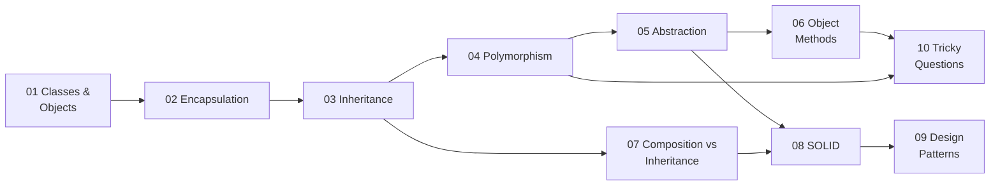

<div align="center">

# ☕ Java OOP Interview Questions

**Object-Oriented Programming interview questions for Java, with answers and runnable code for every topic.**


[Topics](#-topics) · [Quick Start](#-quick-start) · [Study Path](#%EF%B8%8F-study-path) · [Sample Questions](#-sample-questions) · [Cheat Sheet](#-cheat-sheet) · [Contributing](#-contributing)

</div>

---

## 📖 About

This repo collects the OOP questions that come up again and again in Java interviews, from "what is a class?" to "why does `Square extends Rectangle` break Liskov?" Each answer is:

- ✅ **Short enough to say out loud.** Answers are written the way you'd explain them to an interviewer, not copied from a textbook.
- ✅ **Backed by code you can run.** Every topic has a demo program that shows the concept, including the bugs that happen when you get it wrong.
- ✅ **Followed by the next question.** The **Follow-up** sections cover what interviewers ask after your first answer, which is where they find out whether you understand the concept or memorized it.

---

## 📚 Topics

| # | Topic | Key concepts | Questions | Demo |
|:-:|-------|--------------|:-:|------|
| 01 | [**Classes & Objects**](01-classes-and-objects/) | Constructors, `this`, `static`, initialization order | 8 | [`ClassesDemo`](01-classes-and-objects/ClassesDemo.java) |
| 02 | [**Encapsulation**](02-encapsulation/) | Access modifiers, getters that leak state, immutability | 6 | [`EncapsulationDemo`](02-encapsulation/EncapsulationDemo.java) |
| 03 | [**Inheritance**](03-inheritance/) | `super`, constructor chaining, the diamond problem, sealed classes | 7 | [`InheritanceDemo`](03-inheritance/InheritanceDemo.java) |
| 04 | [**Polymorphism**](04-polymorphism/) | Overloading vs overriding, dynamic dispatch, covariant returns | 8 | [`PolymorphismDemo`](04-polymorphism/PolymorphismDemo.java) |
| 05 | [**Abstraction**](05-abstraction/) | Abstract class vs interface, default methods, Template Method | 9 | [`AbstractionDemo`](05-abstraction/AbstractionDemo.java) |
| 06 | [**Object Class Methods**](06-object-class-methods/) | `equals`/`hashCode` contract, `toString`, shallow vs deep copy | 8 | [`ObjectMethodsDemo`](06-object-class-methods/ObjectMethodsDemo.java) |
| 07 | [**Composition vs Inheritance**](07-composition-vs-inheritance/) | Has-a vs is-a, delegation, the fragile base class problem | 5 | [`CompositionDemo`](07-composition-vs-inheritance/CompositionDemo.java) |
| 08 | [**SOLID Principles**](08-solid-principles/) | SRP, OCP, LSP, ISP, DIP in one worked example | 6 | [`SolidDemo`](08-solid-principles/SolidDemo.java) |
| 09 | [**Design Patterns**](09-design-patterns/) | Singleton, Factory, Builder, Strategy, Observer | 7 | [`PatternsDemo`](09-design-patterns/PatternsDemo.java) |
| 10 | [**Tricky Questions**](10-tricky-questions/) | "Predict the output": hiding, `Integer` cache, `finally` | 11 | [`TrickyDemo`](10-tricky-questions/TrickyDemo.java) |

---

## 🚀 Quick Start

### Prerequisites

- **JDK 17 or newer.** Check with `java -version`. If you don't have it, [Eclipse Temurin](https://adoptium.net/) is a free download.
- No Maven, Gradle or IDE needed. Each topic is plain `.java` files.

### Clone the repo

```bash
git clone https://github.com/<your-username>/<repo-name>.git
cd <repo-name>
```

### Run one topic

```bash
cd 04-polymorphism
javac -d out *.java
java -cp out PolymorphismDemo
```

### Run every topic

<table>
<tr><th>Windows (PowerShell)</th><th>macOS / Linux / Git Bash</th></tr>
<tr>
<td>

```powershell
./run-all.ps1
```

</td>
<td>

```bash
./run-all.sh
```

</td>
</tr>
</table>

### Example output

```text
===== 07-composition-vs-inheritance =====
Inheritance addCount (expected 3): 6
Composition addCount: 3
Car starts: Vroom
Car starts: Hmmm
```

> 💡 The `6` in that output is intentional. It's the **fragile base class problem**: `HashSet.addAll` calls `add` internally, so the subclass counts every element twice. [Topic 07](07-composition-vs-inheritance/) explains why.

---

## 🗺️ Study Path

Each topic builds on the ones before it, so if you're new to OOP, go in order. If you're revising before an interview, start with **06**, **08**, **09** and **10**, because those come up most often in interviews.



### How to study each topic

1. **Answer first.** Read a question, cover the answer, and explain it out loud as if you were in the interview.
2. **Predict, then run.** Guess what the demo prints before running it. When your guess is wrong, that's a gap worth studying.
3. **Do the follow-ups.** Interviewers rarely stop after the first answer.
4. **Write it from memory.** For design patterns especially, close the file and write a Singleton or Builder from scratch.

---

## 🎯 Sample Questions

Click a question to see the answer. The full set is in each topic folder.

<details>
<summary><b>What's the difference between overloading and overriding?</b></summary>
<br>

| | Overloading | Overriding |
|---|---|---|
| Signature | Different parameters | Same signature |
| Resolved | Compile time | Runtime |
| Return type | Can differ | Same or a subtype (covariant) |
| `static`/`private`/`final` | Can be overloaded | Cannot be overridden |

More in [04 Polymorphism](04-polymorphism/).
</details>

<details>
<summary><b>What happens if you override <code>equals</code> but not <code>hashCode</code>?</b></summary>
<br>

Hash-based collections break. Two "equal" objects land in different buckets, so a `HashSet` keeps duplicates and `map.get(equalKey)` returns `null`. The rule is: **if `a.equals(b)`, then `a.hashCode() == b.hashCode()`**.

More in [06 Object Class Methods](06-object-class-methods/).
</details>

<details>
<summary><b>Is Java pass-by-value or pass-by-reference?</b></summary>
<br>

**Always pass-by-value.** For objects, the value passed is a *copy of the reference*. A method can change the object it receives, but it can't make the caller's variable point to a different object.

More in [10 Tricky Questions](10-tricky-questions/).
</details>

<details>
<summary><b>What's the best way to write a thread-safe Singleton?</b></summary>
<br>

The **initialization-on-demand holder** pattern is lazy, thread-safe and needs no locks:

```java
final class AppConfig {
    private AppConfig() {}
    private static class Holder { static final AppConfig INSTANCE = new AppConfig(); }
    static AppConfig getInstance() { return Holder.INSTANCE; }
}
```

An `enum` singleton is also a good answer, because it resists reflection and serialization attacks.

More in [09 Design Patterns](09-design-patterns/).
</details>

<details>
<summary><b>What does <code>A ref = new B(); ref.staticMethod()</code> call?</b></summary>
<br>

**`A`'s version.** Static methods are *hidden*, not overridden. The compiler picks the method from the reference type (`A`), not from the object's actual type.

More in [10 Tricky Questions](10-tricky-questions/).
</details>

---

## 📝 Cheat Sheet

<details>
<summary><b>The four pillars of OOP</b></summary>
<br>

| Pillar | In one line | Java mechanism |
|---|---|---|
| **Encapsulation** | Hide state and expose behavior | `private` fields, methods that enforce rules |
| **Abstraction** | Show *what*, hide *how* | `interface`, `abstract class` |
| **Inheritance** | Reuse through an is-a relationship | `extends`, `implements` |
| **Polymorphism** | One interface, many implementations | Overloading, overriding |

</details>

<details>
<summary><b>Abstract class vs interface</b></summary>
<br>

| | Abstract class | Interface |
|---|---|---|
| Instance fields | ✅ | ❌ (constants only) |
| Constructors | ✅ | ❌ |
| How many a class can have | One | Many |
| Best for | Related classes sharing state or code | Capabilities that unrelated classes can share |

</details>

<details>
<summary><b>SOLID in one table</b></summary>
<br>

| | Principle | Remember it as |
|---|---|---|
| **S** | Single Responsibility | One reason to change |
| **O** | Open/Closed | Add new classes instead of editing old ones |
| **L** | Liskov Substitution | A subclass must work anywhere its parent does |
| **I** | Interface Segregation | Small, focused interfaces |
| **D** | Dependency Inversion | Depend on interfaces, inject the implementations |

</details>

<details>
<summary><b>Access modifiers</b></summary>
<br>

| Modifier | Class | Package | Subclass | Everywhere |
|---|:-:|:-:|:-:|:-:|
| `private` | ✅ | ❌ | ❌ | ❌ |
| *(none)* | ✅ | ✅ | ❌ | ❌ |
| `protected` | ✅ | ✅ | ✅ | ❌ |
| `public` | ✅ | ✅ | ✅ | ✅ |

</details>

---

## 📁 Project Structure

```text
.
├── 01-classes-and-objects/
│   ├── README.md               ← questions & answers
│   └── ClassesDemo.java        ← runnable example
├── 02-encapsulation/
├── ...
├── 10-tricky-questions/
├── run-all.ps1                 ← run every demo (Windows)
├── run-all.sh                  ← run every demo (macOS / Linux)
└── README.md                   ← you are here
```

Each topic folder is self-contained. The demos use nested classes and no package declarations, so a single `javac *.java` compiles a whole topic.

---

## 🤝 Contributing

New questions, better explanations and fixes are all welcome.

1. **Fork** the repo and create a branch: `git checkout -b add-generics-questions`
2. Add your question to the right topic's `README.md` in the same format:
   ```markdown
   ### Qn. Your question here?

   A short answer you could say in an interview.

   **Follow-up:** *A question the interviewer is likely to ask next.* Its answer.
   ```
3. If it needs code, add it to that topic's demo file and check that it compiles and runs.
4. Open a **pull request** that says what you added.

### Ideas for new topics

- [ ] Exceptions & exception hierarchy
- [ ] Generics & type erasure
- [ ] Inner, nested, local & anonymous classes
- [ ] Records, sealed types & pattern matching in depth
- [ ] Object-oriented design problems (parking lot, library system, elevator)

---

<div align="center">

**If this repo helps you prepare, consider giving it a ⭐.**

Made by [Muhammad Absar ul Haque](https://github.com/Muhammad-Absar-ul-Haque)

</div>
